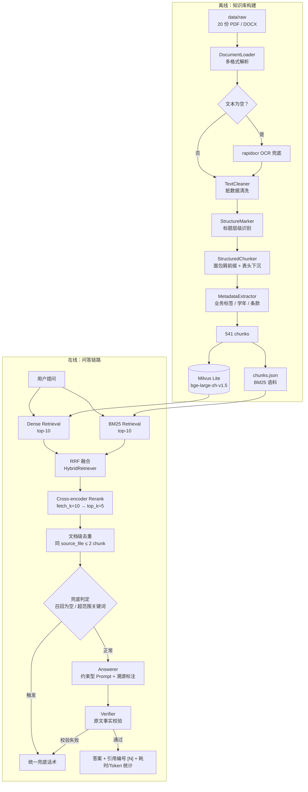

# 高校教务政策智能问答系统（RAG）

基于 **20 份真实教务文件**（PDF / DOCX，含扫描件）构建的端到端 RAG 问答系统，覆盖
**文档解析 → 结构化切分 → 多路召回 → 精排去重 → 生成溯源 → 幻觉治理 → API 服务化 → 压测与版本管理**全链路。

自建 **120 题黄金测试集**驱动五级消融优化，全部实验结果落盘可复现。

| 核心指标 | 纯向量基线 | 生产链路（Hybrid + Rerank + 去重） | 增量 |
|---|---|---|---|
| Top-1 召回率 | 75.89% | **78.57%** | +2.68pp |
| Top-3 召回率 | 89.29% | **97.32%** | **+8.03pp** |
| Top-5 召回率 | 93.75% | **99.11%** | +5.36pp |
| 表格类 Top-1 | 87.10% | **96.77%** | **+9.67pp** |
| 表格类 Top-3 | 96.77% | **100%** | +3.23pp |
| 超范围问题拒答率 | — | **100%**（8/8） | — |

> 指标口径：120 题黄金测试集（含 31 条表格类、8 条负样本），命中判定为 `source_file` **文档级精确匹配**，负样本不计入召回率分母。
> 结果来源：`docs/eval_results/vector_new/`（基线）、`docs/eval_results/hybrid_rerank_dedup2/`（生产链路）。详见 [评估体系](#-评估体系)。

---

## 目录

- [技术栈](#-技术栈)
- [系统架构](#-系统架构)
- [快速开始](#-快速开始)
- [API 接口](#-api-接口)
- [检索链路与优化历程](#-检索链路与优化历程)
- [评估体系](#-评估体系)
- [生成侧：幻觉治理与答案溯源](#-生成侧幻觉治理与答案溯源)
- [工程化：可观测性、压测与版本管理](#-工程化可观测性压测与版本管理)
- [关键设计决策](#-关键设计决策)
- [已知局限与后续计划](#-已知局限与后续计划)
- [项目结构](#-项目结构)
- [文档索引](#-文档索引)

---

## 技术栈

| 层次 | 选型 |
|---|---|
| 编排框架 | LangChain 0.3（`langchain` / `langchain-community` / `langchain-milvus` / `langchain-text-splitters`） |
| 向量库 | Milvus Lite（本地文件 `./milvus_academic.db`，collection `academic_affairs`） |
| Embedding | `BAAI/bge-large-zh-v1.5`（1024 维，SiliconFlow API） |
| 关键词检索 | `rank_bm25` + `jieba`（预置 13 个教务领域自定义术语） |
| 精排模型 | `BAAI/bge-reranker-v2-m3`（Cross-encoder，SiliconFlow Rerank API） |
| 生成模型 | DeepSeek / Qwen2.5（OpenAI 兼容接口，`.env` 可切换） |
| 文档解析 | `pdfplumber`（PDF）、`python-docx`（Word）、`beautifulsoup4`（HTML）、`rapidocr-onnxruntime`（扫描件 OCR 兜底） |
| 服务层 | FastAPI + Uvicorn + `sse-starlette`（SSE 流式）+ `httpx`（异步压测） |
| 评估 | 自建黄金测试集 + 统一评估入口（`src/evaluation.py`），`ragas` 备用 |

---

## 系统架构



**分层职责**

| 模块 | 路径 | 职责 |
|---|---|---|
| 预处理 | `src/preprocessing/` | 加载、清洗、结构标记、切分、元数据抽取，编排为 `PreprocessingPipeline` |
| 向量存储 | `src/vectorstore.py` | SiliconFlow Embedding 封装（三级容错）、Milvus 建库 / 加载、延迟与 Token 追踪 |
| 检索 | `src/retrieval/` | `BM25Retriever`、`HybridRetriever`（RRF / 加权融合）、`RerankRetriever` + `deduplicate_by_source` |
| 查询改写 | `src/query/rewriter.py` | 术语词典 + LLM 多查询生成 + 加权二次融合（**经消融验证净收益为负，生产链路已下线**，保留 `use_llm` 开关） |
| 生成 | `src/generation/` | `LLMClient`、`Answerer`（溯源标注）、`citation`、`verifier`（原文校验）、`fallback`（无依据兜底） |
| 服务 | `src/api/` | FastAPI 应用、全链路中间件、`history`（线程安全环形缓冲） |
| 评估 | `src/evaluation.py` | `evaluate_recall`：单次取 top-10 切 top1/3/5，输出整体 + 表格子集双套指标与逐题明细 |
| 版本管理 | `src/versioning.py` | 按 `academic_year` 标签的增量导入 / 重建 / 回滚，Milvus 与 `chunks.json` 双写一致 |

---

## 快速开始

### 1. 环境要求

- Python 3.10+（开发环境使用 3.14）
- 一个 OpenAI 兼容的大模型 API Key（推荐 [SiliconFlow](https://cloud.siliconflow.cn)，注册即送额度，可同时用于 Embedding / Rerank / LLM）

### 2. 安装依赖

```bash
git clone https://github.com/liujiawei2006/academic-affairs-qa.git
cd academic-affairs-qa
python -m venv .venv
# Windows PowerShell
.venv\Scripts\Activate.ps1
# macOS / Linux
# source .venv/bin/activate
pip install -r requirements.txt
```

### 3. 配置环境变量

```bash
cp .env.example .env
```

编辑 `.env`：

```ini
LLM_BASE_URL=https://api.siliconflow.cn/v1
LLM_API_KEY=sk-你的密钥
LLM_MODEL=deepseek-ai/DeepSeek-V3

# 可选
LLM_TEMPERATURE=0.7
LLM_MAX_HISTORY=20
LLM_TIMEOUT=60
LLM_SYSTEM_PROMPT=你是高校教务政策知识库问答系统的AI助手...

# 可选：覆盖默认模型（不填则使用下列默认值）
EMBEDDING_MODEL=BAAI/bge-large-zh-v1.5
RERANK_MODEL=BAAI/bge-reranker-v2-m3
MILVUS_URI=./milvus_academic.db
```

### 4. 准备语料并建库

把教务文档（PDF / DOCX / HTML）放入 `data/raw/`，然后执行：

```bash
# 预处理 + 建向量库 + 导出 BM25 语料 + 跑基线评估（一键完成第 1 周全流程）
python run_week1.py
```

产出：

- `milvus_academic.db/`：Milvus Lite 向量库
- `data/processed/chunks.json`：BM25 语料（541 条，与向量库同源）

> 已有向量库但缺 `chunks.json` 时，无需重跑 Embedding：
> ```bash
> python export_chunks_from_milvus.py
> ```

### 5. 命令行问答

```bash
python run_qa.py
```

交互式输入问题，系统完成「检索 → 生成 → 校验」并打印答案、引用来源与校验报告，输入 `q` 退出。

### 6. 启动 HTTP 服务

```bash
python run_api.py
```

- 服务地址：`http://localhost:8000`
- Swagger 文档：`http://localhost:8000/docs`
- 可观测性看板：`http://localhost:8000/dashboard`

---

## API 接口

| 方法 | 路径 | 说明 |
|---|---|---|
| POST | `/qa` | 问答（同步 JSON 响应，含引用、耗时、Token 统计） |
| POST | `/qa/stream` | 问答（SSE 逐 token 流式输出） |
| GET | `/health` | 健康检查（Milvus + LLM 双探活，返回 `ok` / `degraded`） |
| GET | `/dashboard` | 实时可观测性看板（请求明细、平均耗时、兜底率、Token 消耗，10s 自动刷新） |
| GET | `/api/history` | 请求历史（线程安全环形缓冲，最近 100 条） |

### 请求示例

```bash
curl -X POST http://localhost:8000/qa \
  -H "Content-Type: application/json" \
  -d '{"question": "一等奖学金的绩点要求是多少？", "enable_verify": true}'
```

### 响应结构

```jsonc
{
  "question": "一等奖学金的绩点要求是多少？",
  "answer": "根据《浙江工业大学本科学生奖学金评定及管理办法》，一等奖学金要求平均学分绩点不低于 3.8 [1]...",
  "citations": [
    {
      "marker": "[1]",
      "source_file": "2 浙工大发〔2022〕47号...奖学金评定及管理办法.pdf",
      "doc_title": "《浙江工业大学本科学生奖学金评定及管理办法》",
      "chapter": "第三章",
      "article": "第六条",
      "table_row": ""
    }
  ],
  "fallback": { "should_fallback": false, "reason": "" },
  "timing": {
    "retrieval_s": 0.79,        // 检索
    "context_build_s": 0.01,    // Context 构建
    "llm_s": 6.20,              // LLM 生成
    "verify_s": 0.02            // 事实校验
  },
  "token_usage": {
    "prompt_tokens": 2362,
    "completion_tokens": 213,
    "total_tokens": 2575,
    "call_count": 1
  }
}
```

### SSE 流式事件类型

| event | 说明 |
|---|---|
| `token` | 增量文本片段 |
| `fallback` | 触发兜底，携带兜底原因 |
| `done` | 结束事件，携带 citations / timing / token_usage |
| `error` | 流中异常（不中断连接，以事件形式推送） |

### 错误码约定

| 状态码 | 含义 |
|---|---|
| 500 | 未处理异常（响应体含 `request_id` 便于追溯） |
| 503 | 服务未初始化（检索链路加载失败） |
| 504 | 请求超时（`asyncio.wait_for` 全局兜底，默认 120s） |

所有响应头携带 `X-Request-ID` 与 `X-Response-Time`。

---

## 检索链路与优化历程

### 生产链路配置

```
HybridRetriever(Dense top-10 + BM25 top-10, fusion=RRF k=60)
  └─ RerankRetriever(bge-reranker-v2-m3, fetch_k=10 → top_k=5)
       └─ deduplicate_by_source(max_per_source=2)
```

**不启用 Query 改写**（原因见 [关键设计决策](#-关键设计决策)）。

### 逐级消融（99 题消融集，用于归因每一级的作用边界）

| 阶段 | 关键技术 | Top-1 | Top-3 | Top-5 | 表格 Top-1 | 结果目录 |
|---|---|---|---|---|---|---|
| 基线 | 纯向量 `bge-large-zh-v1.5` | 74.73% | 92.31% | 94.51% | 86.96% | `vector/` |
| + BM25 多路 | `weighted 0.5/0.5`（7 组配比消融选定） | 71.43% ↓ | 93.41% | **97.80%** ↑ | 78.26% ↓ | `hybrid/` |
| + Query 改写 | LLM 多查询 + 加权二次融合 | 70.33% ↓ | 92.31% | 97.80% | 78.26% | `rewrite/` **已下线** |
| + Rerank | Cross-encoder 精排（挂 hybrid） | **79.12%** ↑↑ | 92.31% | 94.51% | **91.30%** ↑↑ | `hybrid_rerank/` |
| + 文档级去重 | 同 `source_file` ≤ 2 chunk | 78.02% | **96.70%** ↑ | **98.90%** ↑ | 95.65% | `hybrid_rerank_dedup2_boost/` |

> 上表为 99 题消融集口径（表格类 23 条），用于归因每一级的作用边界；所有结果目录位于 `docs/eval_results/` 下。生产链路在 120 题集上的最终指标见文首表格。

### 每一级解决什么问题（核心结论）

| 组件 | 作用边界 | 数据支撑 |
|---|---|---|
| **BM25 多路** | **扩池**，不是排序 | Top-5 +3.29pp（把掉出候选的正确文档捞回来），但 Top-1 −3.30pp（打分粒度粗，排不上去） |
| **Cross-encoder Rerank** | **精排**，尤其挽救表格子集 | Top-1 +7.69pp vs hybrid，表格 Top-1 +13.04pp |
| **文档级去重** | **释放槽位**（等价隐式 MMR） | Top-3 +4.39pp，直接修复 4 条「单文档占满 Top-3」的 miss |
| **Query 改写** | 仅当 base retriever 弱时有效 | 本项目 Top-5 已 97.80%，提升:退步 ≈ 1:2，**净收益为负** |

### Embedding 模型选型对比

同一份 chunk、同一测试集、同一评估口径，仅切换 Embedding 模型，两模型各建独立 collection（向量空间隔离）：

| 模型 | Top-1 | Top-3 | Top-5 | 表格 Top-1 | 相对延迟 |
|---|---|---|---|---|---|
| **`bge-large-zh-v1.5`（选定）** | **74.73%** | **92.31%** | 94.51% | 86.96% | 1× |
| `bge-m3` | 64.84% | 85.71% | **97.80%** | 82.61% | ~2× |

结果目录：`docs/eval_results/embedding_bge_large/`、`embedding_bge_m3/`、`embedding_comparison/`。

结论：中文短文本场景下，纯中文优化模型的语义区分度显著优于多语言通用模型——**「模型更大 / 更新 ≠ 效果更好」，必须做场景化 A/B**。

### 复现评估

```bash
# 统一评估入口（任意 retriever 均实现 .invoke(query) → list[Document]）
python run_retrieval_eval.py --label baseline --top_k 10

# 阶段一：7 组融合策略消融（纯向量 / 纯 BM25 / RRF k=20,60 / 加权 3 种配比）
python run_hybrid_eval.py

# 阶段二：Query 改写 5 组消融（vector / hybrid / dict_only / llm_only / full_rewrite）
python run_rewrite_eval.py

# 阶段三：Rerank 增量评估（hybrid vs +rerank vs +rerank+dedup）
python run_rerank_eval.py --dedup --max-per-source 2

# 阶段四：Embedding 双模型对比建库 + 评估
python run_embedding_eval.py

# 生成侧：幻觉率评估（约束 Prompt + 校验 + 兜底 前后对比）
python run_hallucination_eval.py
```

每组结果落盘至 `docs/eval_results/<label>/{result.json, report.md}`，含逐题明细与 badcase 列表。

---

## 评估体系

### 黄金测试集

`tests/golden_dataset.jsonl`，从 50 条扩充至 **120 条**：

| 类型 | 说明 |
|---|---|
| 原始文档级问题 | 覆盖全部 20 份教务文档 |
| 口语化变体 | 「挂科了还能拿奖学金吗」「计算机专业毕业要修多少学分」 |
| 负样本（应拒答） | 研究生奖学金、转专业、辅修、宿舍、社团等**知识库无覆盖**问题 |
| 跨文档推理 | 需聚合多份文档才能回答 |
| 表格类子集 | `is_table_question=true` 标记，**全程独立统计** |

答案级评估集：`tests/golden_dataset_answer.jsonl`（含 `expected_values` / `expected_conditions` / `expected_answer_points`）。

### 评估口径（固定约定）

- 每路召回 top-10，切片看 Top-1 / Top-3 / Top-5
- 命中判定：`metadata.source_file` ∈ 期望文件集合（**文档级**，非 chunk 级）
- 负样本不计入召回率分母
- 指标拆「整体 + 表格子集」两套，避免**整体指标良好但子集退化**被掩盖
- 逐题输出 `improved` / `regressed` / `unchanged` 分类，支撑归因分析

### 一次重要的自我修正：标签级 → 文档级

初版评估用 `business_tag`（业务标签）做匹配，得到 **Top-1 94% / Top-3 100% / Top-5 100%** 的「优异」结果。

排查发现：20 份文档只映射到 7 个标签，**同标签不同文档的分片被误判为命中**，top-5 随机命中概率本就很高——指标严重虚高。

升级为 `source_file` 文档级精确匹配（并修正测试集中缺失数字前缀的文件名，如 `"2 "` / `"7 "`）后，基线回归真实的 **74.7% / 92.3% / 94.5%**。

> 这次「指标下降」是本项目最有价值的一步：**虚高的 100% 没有优化空间，真实的 74.7% 才有**。后续所有优化都建立在这个可信基线之上。

---

## 生成侧：幻觉治理与答案溯源

### 四层幻觉抑制机制

| 层 | 实现 | 说明 |
|---|---|---|
| C1 条件句式清单 | 从语料抽取 **272 处**条件句式 | 明确「政策类答案必须逐条列条件」的结构约束 |
| C2 约束型 Prompt | `src/generation/answerer.py` | 强制条件句逐条列出、表格数值原样引用、无依据时转兜底话术 |
| C3 原文事实校验 | `src/generation/verifier.py` | 正则抽取答案中的数值 / 条件项 → 归一化 → 回原文 context 匹配 → 未命中标记「疑似幻觉」 |
| D1 无依据兜底 | `src/generation/fallback.py` | **前置拦截**（召回为空 / 命中超范围关键词）+ **后置拦截**（校验失败），前置拦截可省下 LLM 调用 |

### 效果（112 正样本 + 8 负样本）

| 指标 | 优化前（朴素 Prompt） | 优化后（四层机制） | 变化 |
|---|---|---|---|
| 数值准确率 | 40.8% | **50.7%** | **+9.9pp** |
| 表格数值准确率 | 36.1% | **47.0%** | **+10.8pp** |
| 负样本拒答率 | — | **100%**（8/8） | 全部正确拦截 |

### 答案溯源

每条结论强制标注 `[N]` 引用编号，后处理映射回真实来源，支持「依据《XX 管理办法》第六条 [1]」格式，用户可一键追溯原始政策文件，提升可信度与可审计性。溯源字段：`source_file` / `doc_title` / `chapter` / `article` / `table_row`。

---

## 工程化：可观测性、压测与版本管理

### 全链路可观测性

- **中间件层**：每个请求分配唯一 `request_id`（UUID 前 8 位），经响应头 `X-Request-ID` / `X-Response-Time` 透传
- **四阶段耗时埋点**：检索 → 上下文构建 → LLM 生成 → 事实校验，各阶段独立计时并自动算占比
- **Token 四维统计**：`prompt_tokens` / `completion_tokens` / `total_tokens` / `call_count`
- **实时看板** `/dashboard`：请求明细、平均耗时、兜底率、Token 消耗
- **全局异常中间件**：统一捕获未处理异常，返回含 `request_id` 的结构化错误响应

### 服务稳定性

- `lifespan` + `run_in_executor` 线程池加载检索链路单例，**避免同步阻塞事件循环**
- `asyncio.wait_for(future, timeout=120)` 全局超时兜底，超时自动取消 future
- `/health` 双探活（Milvus collection + LLM 配置），返回 `ok` / `degraded`
- 流式输出中异常不中断连接，通过 `event: error` 推送
- 并发下 Token 统计采用**差值法**（流前 / 流后相减），规避全局计数器竞态

### 压测与瓶颈定位

```bash
python run_api.py            # 先启动服务
python run_stress_test.py --concurrency 5 --total 10
```

`httpx.AsyncClient` + `asyncio.Semaphore` 控制并发，自动采集 P50/P95/P99、成功率、Token 消耗并生成 Markdown 报告（`docs/stress_test_report.md`）。

实测结果：

| 指标 | 总耗时 | 检索 | LLM 生成 |
|---|---|---|---|
| 平均 | 7.14s | 0.79s | 6.20s |
| P50 | 6.03s | 0.77s | 5.08s |
| P95 | 13.00s | 1.27s | 12.09s |
| P99 | 14.34s | 1.27s | 13.86s |

成功率 100%。**瓶颈定位：LLM 生成占总耗时 87%，检索仅占 11%** —— 因此检索侧继续优化的边际收益很低，体验优化优先级应为：流式输出（已实现 SSE）> 高频问题缓存 > 更换更快的模型。

### 知识库版本管理

政策文件每年更新，为此设计按 `academic_year` 标签的版本方案，所有写操作**同步更新 Milvus 向量库与 BM25 语料文件**，保证双路数据一致：

```bash
# 列出所有学年及 chunk 数
python run_rebuild.py --list-years

# 统计某学年
python run_rebuild.py --count 2025-2026

# 增量导入新文件到指定学年
python run_import.py --dir data/raw/2025-2026新政策 --academic-year 2025-2026

# 按学年重建（先删后导，操作前打印影响范围）
python run_rebuild.py --rebuild 2025-2026 --dir data/raw/2025-2026新政策

# 版本回滚（按学年 + 文件名双条件精确删除）
python run_rebuild.py --rollback 2025-2026
```

危险操作需二次确认，可用 `--force` 跳过。详见 [`docs/version_management.md`](docs/version_management.md)。

---

## 关键设计决策

### 1. Query 改写为什么下线？

实现了完整三层架构（术语词典 + LLM 多查询生成 + 分数加权二次融合），迭代 4 轮、跑了 5 组消融，最终**主动下线**。

**因果链**：多查询扩展的收益前提是「原始 query 检索质量差」。但本项目 base hybrid retriever 的 Top-5 已达 **97.80%**——正确文档基本都在候选池里，问题只剩排序。此时生成 2 个语义变体：

1. 变体与原始 query 语义重叠度 >90%，检索结果集高度雷同 → RRF 融合等于**给同一批文档重复投票**，85% 的题目排名不变
2. 少数变体因 LLM 表述偏移引入噪声文档 → 在 RRF 里获得额外票数，**把正确文档挤出 Top-1**（提升:退步 ≈ 1:2）
3. 即使把原始 query 权重加到 2.0，也只能减缓、无法消除稀释

**4 轮迭代中的根因转移**（同一现象「退步」，先后定位到三个不同根因）：

| 轮次 | 根因定位 | 动作 |
|---|---|---|
| 1 | Prompt 过松（泛化专有名词）+ 词典重复追加 + 等权 RRF 稀释 | 严格 Prompt、`seen_formal` 去重、加权二次 RRF |
| 2 | Qwen2.5-7B **系统性幻觉**（反复把「省政府奖学金特别优秀」塞进无关问题） | 换 DeepSeek |
| 3 | 根因从模型问题转为**架构问题**：双层融合冲突（第一层分数融合 + 第二层 RRF 丢弃分数） | 第二层改分数加权，`original_weight=3.0` > 变体权重和 2.0 |
| 4 | 5 组消融确认：base retriever 已较优时多查询扩展净收益为负 | **决策下线，保留代码与开关** |

> **方法论收获：优化手段必须匹配瓶颈位置。瓶颈在排序时做 query 扩展，是南辕北辙。**

### 2. 为什么 BM25 在教务场景收益大？

教务文档的特点是**同族文档密集，而区分它们的恰恰是低语义权重的专名 token**。

语料里有 4 份培养计划（计算机科学与技术 / 软件工程 / 网络工程 / 数字媒体技术），80% 内容结构完全一样，Embedding 把它们映射到几乎重合的点。用户问「计算机科学与技术专业毕业要修多少学分」，向量检索 Top-3 返回的是网络工程、软件工程、数字媒体——**语义上它没错，确实都是「培养计划 + 学分」**。

但在词法空间，「计算机科学与技术」在 541 个 chunk 中只出现在极少数 chunk 里，**BM25 的 IDF 机制天然放大这类低频高判别力 token**。同类场景还有文号（`46号` vs `47号`）、奖项名、制度类型（「补充说明」vs「认定办法」）。

为此在 jieba 中预置 13 个教务术语自定义词典，解决「平均学分绩点」被切成「平均 / 学分 / 绩点」的问题。

**但 BM25 有明确收益边界**：纯 BM25 Top-1 仅 60%（单独不可用）；扩池强、排序弱（必须配 Rerank）；表格场景反而有害（可分词 token 极少，等权融合时稀释向量路优势，表格 Top-1 掉 8.7pp）。

### 3. 表格类问题为什么难？为什么 Rerank 收益最大？

三层同时失效：

- **切分层**：表头与数据行被切开，chunk 里可能只剩 `3.5 | 2 | 1` 裸数字矩阵
- **检索层**：BM25 失效（可分词 token 极少，打分接近 0）；Embedding 也失效（用户问「省政府奖学金有多少名额」，chunk 里可能只有「项目名称 / 名额 / 备注」表头，关键词根本不在）
- **排序层**：只有 Cross-encoder 能救 —— Bi-encoder 把 query 和 chunk **独立**编码再算余弦；Cross-encoder 把 `(query, chunk)` **拼接后一起过 Transformer**，每层 self-attention 做 token 级交叉，即使 chunk 只有裸数字，也能靠 query 里的「一等奖学金绩点要求」激活判断

实测表格 Top-1 **+13.04pp**，是所有子集里收益最大的一项。但 **Rerank 是补救不是根治**，根治在切分阶段：表格整块保留 + 表头下沉 + Markdown 化。

### 4. 文档级去重为什么能带来 Top-3 +4.39pp？

Rerank 后存在严重的**槽位浪费**：同一文档的多个 chunk 语义几乎相同、rerank score 高度接近，倾向被排在相邻位置。典型表现是 `勤工助学.docx` 一个文档占满 Top-3 全部 3 个槽位。

去重（同 `source_file` 最多保留 2 个 chunk）的作用是**强制多样性**，多出的槽位自动让给排名靠后的其他文档——相当于在 Rerank 后加了一层隐式 MMR，但不需要计算 query-document 相似度，仅靠 `source_file` 维度就能实现有效的多样性控制。

### 5. 工程健壮性设计

- **Embedding API 三级容错**：原文调用 → 温和清洗（NFKC 规范化 + 移除控制符/零宽字符）后重试 → 按 500 字符分段重试取均值 → 零向量占位（维度从 `MODEL_DIM_MAP` 查，避免硬编码），**入库成功率 100%**
- **Rerank API 失败自动回退**原始排序，不阻断问答主流程
- **LLM 客户端异常兜底**：失败返回空字符串而非抛异常中断链路
- **LLM 改写结果 MD5 本地缓存**（`data/processed/rewrite_cache.json`）：重复评估从 ~3min 降至 <1s，中断可恢复
- **统一接口契约**：所有 retriever 实现 `.invoke(query) → list[Document]`，`chunk_id` 作为跨路融合去重的文档身份标识，**新增一路检索，评估代码零改动**

---

## 已知局限与后续计划

### 主动交代的评估局限

1. **命中口径是文档级 `source_file` 匹配，不是 chunk 级**——只要命中任意一个 chunk 就算对，指标**偏乐观**
2. **8 条负样本只做了拒答定性观察**，检索层对库外问题依然返回高分结果，缺少量化的拒答准确率
3. **Rerank API 非确定性**：SiliconFlow 每次返回分数有微小差异，同配置多次跑有 ±1pp 波动；理想做法是多次取平均，但 API 成本不允许

### 剩余 badcase 分析（去重后 Top-3 仍未命中 3 条）

**全部不是召回算法能解决的**：

| 类型 | 题数 | 根因 |
|---|---|---|
| 时效性 / 范围缺失 | 2（67%） | 「创新学分认定办法」（长效制度）与「创新分申请补充说明」（本学期）语义同族，「用户问的是本学期」这一信息**不在文本里，在文档的时效属性里** |
| 标注歧义 | 1 | `附件2-"省政府奖学金"特别优秀评选条件.docx` 从字面看比期望文档更匹配问题，属测试集标注质量问题 |

### 后续计划（按性价比排序）

| 优先级 | 动作 | 预期收益 |
|---|---|---|
| P0 | metadata 增加 `effective_date` / `doc_type` / `scope`，检索时按「通知类优先、时间近优先」做业务规则加权 | 解决 67% 的剩余 badcase |
| P1 | 表格切分改造：整块保留 + 表头下沉 + Markdown 化 | 从根治层面提升表格子集 |
| P2 | chunk 级 / 答案片段级评估口径 | 消除文档级匹配的乐观偏差 |
| P2 | 负样本拒答准确率量化 + 生成层 faithfulness 评估 | 补齐评估体系 |
| P3 | 复核标注歧义题目的 `source_files` | 提升测试集质量 |

---

## 项目结构

```
academic-affairs-qa/
├── data/
│   ├── raw/                      # 20 份原始教务文档（PDF / DOCX）
│   └── processed/
│       ├── chunks.json           # 541 条 BM25 语料（与向量库同源）
│       └── rewrite_cache.json    # LLM 改写结果 MD5 缓存
├── docs/
│   ├── eval_results/             # 20+ 组评估结果（每组 result.json + report.md）
│   ├── recall_optimization_report.md   # 召回优化总报告（逐级归因 + badcase 分析）
│   ├── hallucination_cases.md          # 幻觉典型案例
│   ├── stress_test_report.md           # 压测报告
│   ├── version_management.md           # 知识库版本管理方案
│   └── ...
├── src/
│   ├── preprocessing/            # 加载 / 清洗 / 结构标记 / 切分 / 元数据 / 流水线
│   ├── retrieval/                # bm25_retriever / fusion / reranker
│   ├── query/                    # rewriter（已下线，保留开关）
│   ├── generation/               # llm_client / answerer / citation / verifier / fallback
│   ├── api/                      # FastAPI 应用 + 请求历史
│   ├── vectorstore.py            # Embedding 封装（三级容错）+ Milvus 建库/加载
│   ├── evaluation.py             # evaluate_recall：双套指标 + 逐题明细
│   └── versioning.py             # 按学年增量导入 / 重建 / 回滚
├── tests/
│   ├── golden_dataset.jsonl          # 120 题召回评估集
│   ├── golden_dataset_answer.jsonl   # 答案级评估集（幻觉治理）
│   └── golden_dataset_v1.jsonl       # 50 题初版（留存对比）
├── milvus_academic.db/           # Milvus Lite 本地向量库（已 gitignore）
├── run_week1.py                  # 一键：预处理 + 建库 + 基线评估
├── run_qa.py                     # 命令行交互式问答
├── run_api.py                    # 启动 HTTP 服务
├── run_import.py                 # 增量导入
├── run_rebuild.py                # 按学年重建 / 回滚
├── run_retrieval_eval.py         # 召回评估统一入口
├── run_hybrid_eval.py            # 阶段一：7 组融合策略消融
├── run_rewrite_eval.py           # 阶段二：5 组 Query 改写消融
├── run_rerank_eval.py            # 阶段三：Rerank + 去重增量评估
├── run_embedding_eval.py         # 阶段四：Embedding 双模型对比
├── run_hallucination_eval.py     # 生成侧：幻觉率评估
├── run_ablation_eval.py          # 3 组检索策略消融
├── run_stress_test.py            # 异步并发压测
├── export_chunks_from_milvus.py  # 从 Milvus 反查导出 BM25 语料
└── requirements.txt
```

---

## 文档索引

| 文档 | 内容 |
|---|---|
| [`docs/recall_optimization_report.md`](docs/recall_optimization_report.md) | **召回优化总报告**：五级链路逐级归因、badcase 深度分析、面试问答准备 |
| [`docs/recall_four_level_comparison.md`](docs/recall_four_level_comparison.md) | 四级链路对比表 |
| [`docs/hallucination_cases.md`](docs/hallucination_cases.md) | 幻觉典型案例分析 |
| [`docs/baseline_report.md`](docs/baseline_report.md) | 基线评估报告 |
| [`docs/stress_test_report.md`](docs/stress_test_report.md) | 压测报告与瓶颈分析 |
| [`docs/version_management.md`](docs/version_management.md) | 知识库版本管理方案 |
| [`docs/condition_patterns.md`](docs/condition_patterns.md) | 政策条件句式清单（C1 产出） |
| [`总结.md`](总结.md) | 分阶段工作总结：遇到的问题、根因定位与解决路径 |

---

## 说明

- 本项目为个人学习 / 研究项目，语料来自公开的高校教务政策文件，不涉及任何真实学生数据。
- 所有指标均由仓库内脚本在固定测试集上跑出，结果与配置全部落盘于 `docs/eval_results/`，可复现、可追溯。
- 运行需要外部大模型 API（Embedding / Rerank / LLM），请自行配置 `.env` 并注意 API 配额与费用。
